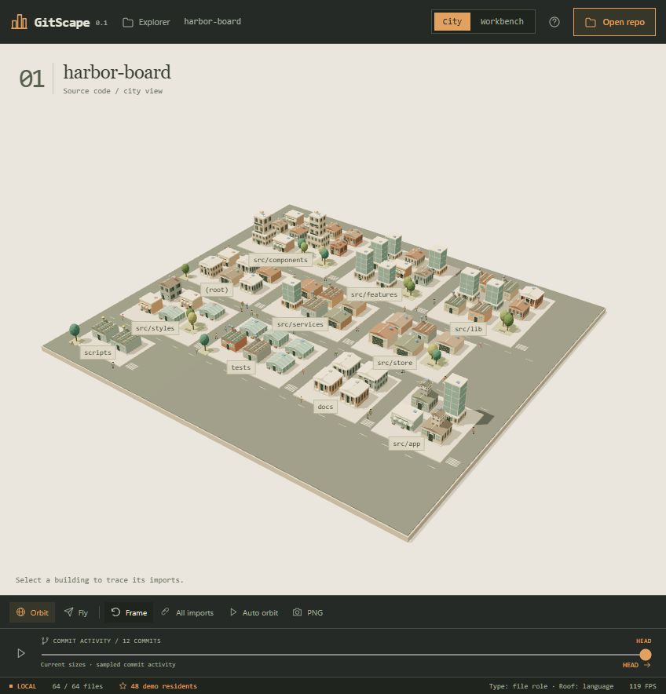
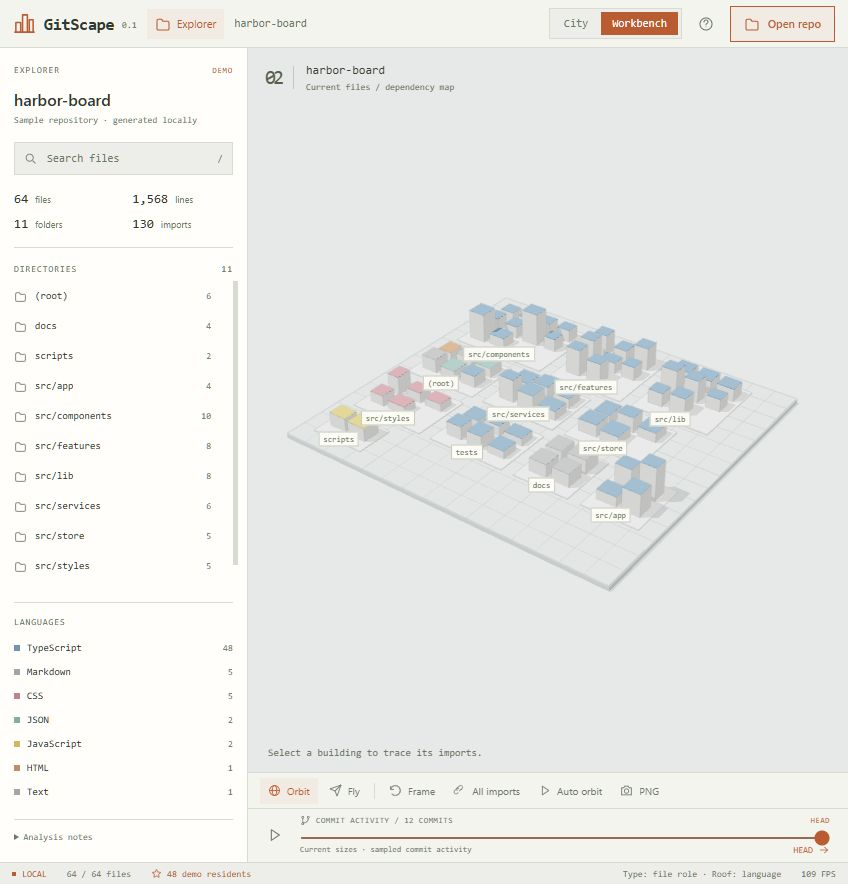

# GitScape

**Your code is a whole world. Explore it.**

*Created entirely with Codex as a learning exercise.*

GitScape turns a source repository into an interactive 3D city. Folders become districts, files become buildings, and local imports connect them. Fly through a project, find the file you need, and open its source without leaving the map.

This is a local prototype. No AI service, account, or API key is needed.

**City** — a compact diorama with masonry buildings, sidewalks, trees and daylight shadows.



**Workbench** — a quiet architectural model, directory explorer and source inspector.



Switch views with **City / Workbench** in the top bar. The selected file, filters and commit position stay intact. Import connections appear for the selected file; **All imports** shows the complete loaded graph.

## What you can explore

- **A code city:** nine building types reflect file purpose, with size responding to line count within each type. Houses, shops, libraries, warehouses, workshops, offices, apartments, clock towers and greenhouses make distinct neighborhoods.
- **Star residents:** connect a public GitHub repository for one resident per star, with visible crowds adapting to zoom. A local GitHub origin is detected automatically. The demo uses 48 explicitly labeled sample residents.
- **Dependencies:** inspect bridges between files that import each other.
- **Source code:** click a building to inspect its path, metrics, and contents.
- **Navigation:** orbit the city or explore it in flight mode; search and filter to focus on part of the project.
- **Your own projects:** paste a public GitHub link, enter a local repository path, or select a folder in the browser.
- **Commit activity playback:** local path analysis can show recent Git commits, highlight changed files, and dim buildings before their first recorded appearance.
- **A shareable view:** export the current city as a PNG.
- **An instant demo:** explore the built-in sample before loading your own code.

## Run locally

Install Node.js 20.19+ or 22.12+. Git is optional, but required to read commit history.

```sh
npm install
npm run dev
```

Open [http://127.0.0.1:4173](http://127.0.0.1:4173). Keep the development process running while using GitScape.

For a production build served on your own machine:

```sh
npm run build
npm start
```

These commands start local services. They do not publish or deploy the project.

## Load a repository

**GitHub link:** click **Open repo → GitHub**, paste `https://github.com/owner/repository` or `owner/repository`, and choose **Open GitHub repository**. GitScape downloads the default branch as a source archive, builds the city, and connects its star population automatically. No account, token, or Git installation is needed. Closing the dialog cancels the download. This opens public repositories; private repositories are not supported. A GitHub source archive has no Git history, so its timeline identifies the current snapshot.

**Local path** gives the richest view. Enter an absolute folder path, such as `C:\projects\my-app` or `/home/me/projects/my-app`. The local Node service reads source files from that folder and can inspect its Git metadata.

**Folder selection** reads files selected through your browser. Browsers do not expose Git history through this workflow, so it shows the selected files without commit metadata.

GitScape analyzes the files you load. Repository analysis does not call a model, send source code to an external service, or fetch remote dependencies. The development server is bound to the loopback interface.

The star button in the bottom status bar manages population. It reads a public GitHub repository's star count from GitHub's metadata API and caches it for ten minutes. This population control does not load repository files or account profiles. Local GitHub origins are detected automatically. Folder imports can be connected manually with `owner/repo`.

The total population keeps one resident per star. Visible figures adapt to zoom: the overview stays readable, and closer streets reveal more people with a smooth fade. Choose **Calm / Lively / Crowd** in the star button's population settings; the preference is saved locally. People use several street lanes, sidewalk promenades, courtyard aisles, crossings, parks and vacant squares, avoiding building footprints.

Animation and visibility run on the GPU. The render pool contains at most 10,000 representative figures, further limited by walking space and density; large star counts do not allocate an object for every resident. This display budget never changes the population counter. City shows the people; Workbench retains the total population and the density preference.

## What the map means

| City element | Repository data |
| --- | --- |
| District | Folder |
| Building | Source file |
| Building type | File purpose and deterministic variation |
| Building size | File length within its building type |
| Building color | Language |
| Bridge | Resolved local import |
| Building details | Current file contents and available metadata |

The map is an exploration aid. Import bridges describe supported static imports, not a complete runtime call graph. Package dependencies and imports that cannot be resolved to loaded files do not become bridges.

## Current limits

- The analyzer skips dependency folders, generated output, binary files, common secret files, and symbolic links. Review the selected folder yourself; filename filters cannot identify every sensitive value inside source code.
- Git metadata is limited to the latest 120 commits. Playback shows commit activity using current building sizes and current source contents; it does not reconstruct the exact repository at each commit. A file's first appearance means its first appearance in the sampled history.
- Analysis accepts up to 1,800 text files, with a 200 KB limit per file and a 24 MB total content limit, so the browser remains responsive. Check the analysis warnings when a project is only partly loaded.
- GitHub downloads have a one-minute timeout, a 48 MB compressed archive limit and a 192 MB expanded archive limit. At most two downloads run concurrently. Larger projects can be opened from a local clone. Archive entries are read in memory without extracting files to disk; links, special entries and unsafe paths are skipped.
- Import resolution is strongest for JavaScript and TypeScript relative imports, including common extension and directory-index patterns. Other languages may have fewer dependency bridges.
- Repository history, renamed files, and dynamically constructed imports are not reconstructed as a complete historical code graph.

## Development

The frontend uses JavaScript, Three.js, and Vite. A small Node service analyzes local files and Git metadata.

```sh
npm test
npm run build
```

Analyzer tests cover import resolution, TypeScript path aliases, commented imports, cyclic imports, excluded files, local Git metadata, filenames containing spaces, and symbolic link boundaries when the operating system allows them.

## Roadmap

- Richer layouts for very large repositories.
- Additional language parsers and dependency resolution.
- More complete history playback.
- Optional guided tours with a user-supplied AI API or local model.

AI tours and API key settings are not implemented in this version. The city works independently of them.

## Contributing

Useful contributions include reproducible layout problems, language support, better import resolution, and improvements to navigation. For a bug report, include your operating system, Node version, the smallest sample project that reproduces it, and any analysis warnings. Do not attach private source code or credentials.

## License

[MIT](LICENSE).
